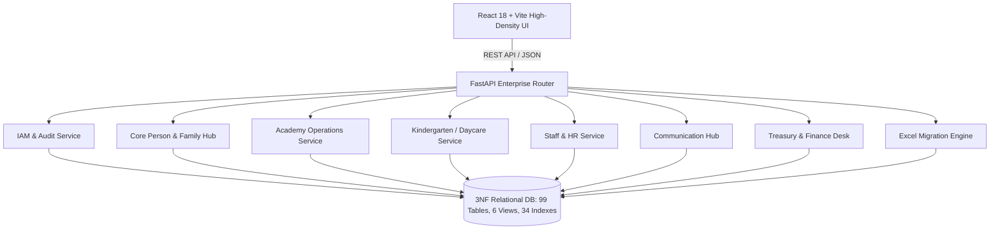

# Genius Kids Academy ERP (3abaqira - عباقرة المستقبل)

An enterprise-grade, multi-branch Educational Resource Planning (ERP) and Information System engineered for **Genius Kids Academy & Kindergarten (أكاديمية وروضة عباقرة المستقبل)** in Jijel, Algeria.

This platform unifies academy training operations, kindergarten daycare tracking, staff human resources, treasury finance, parent communications, and legacy spreadsheet data migration across **13 regional branches** into a single, cohesive, high-density management suite.

---

## 🏛️ System Architecture



### Technology Stack
- **Backend**: FastAPI (Python 3.12), Pydantic v2, SQLite (development) with transparent PostgreSQL dialect compatibility layer.
- **Frontend**: React 18, Vite, Tailwind CSS, Lucide Icons, Canvas/WebGL components, High-Density Excel-grade tabular layouts, full Arabic RTL layout support.
- **Database Schema**: 99 Third-Normal-Form (3NF) tables, 6 materialized views, and 34 specialized compound indexes optimized for fast lookups and strict relational integrity.

---

## 📦 Implemented Functional Modules

### 1. Identity & Access Management (IAM)
- **Role-Based Access Control (RBAC)**: Fine-grained permissions catalog covering Academy Managers, Kindergarten Directors, Receptionists, Cashiers, Trainers, Educators, and Accountants.
- **Activation Gate**: Dynamic student account activation locked until initial registration fee payment is recorded.
- **Audit Trail**: Immutable append-only audit log tracking every user action, status transition, price override, and payment void.

### 2. Organization & 13 Regional Branches Hierarchy
- Multi-branch switcher supporting **Academy** and **Kindergarten/Daycare** branch types across Jijel Province:
  - `CENTER`: Academy & Central HQ (Jijel Center)
  - `RAWDA`: Kindergarten Daycare (Jijel Center)
  - `MILIA_ACADEMY` & `MILIA_RAWDA`: El Milia branches
  - `TAHER_ACADEMY` & `TAHER_RAWDA`: Taher branches
  - `KAOUS_ACADEMY`: Kaous branch
  - `AOUANA_ACADEMY`: El Aouana branch
  - `JIJEL_EST_RAWDA` & `JIJEL_OUEST_ACADEMY`: Jijel East & West branches
  - `CHEKFA_ACADEMY`: Chekfa branch
  - `SIDI_ABDELAZIZ_RAWDA`: Sidi Abdelaziz branch
  - `ZIAMA_ACADEMY`: Ziama Mansouriah branch
- Multi-academic-year selector (`2024-2025`, `2025-2026`, `2026-2027`) ensuring strict historical record isolation.

### 3. Core Person & Family Hub
- **Bilingual Profiles**: English and Arabic names, national identification numbers, birthdates, and gender.
- **Guardian Linkages**: Relational mapping for Fathers, Mothers, and Emergency Guardians with contact numbers and professions.
- **Pickup Authorization Registry**: Photographic identity cards, national ID numbers, and real-time gatekeeper verification check to safeguard children during pickup hours.
- **Medical Drawer**: Chronic illnesses, allergies, special care instructions, emergency physician contacts, and blood types.

### 4. Academy Operations Workstation
- **Course & Level Sequences**: Strict linear level progression rules (e.g., Soroban Level 1 → Level 2 → Level 3; Mental Math, Robotics).
- **Dynamic Pass Rules**: Configurable test threshold engine (e.g., Soroban requiring 3 tests with average >= 80/100 to advance).
- **Timetable & Visual Clash Prevention**: Automatic clash detection preventing double-booking of rooms or trainers in overlapping time slots.
- **Session Attendance Register**: Real-time present/absent/late/excused recording with modal for telephone absence justification logging.
- **Make-up Session Queue**: Automated queue capturing excused absences and routing students to available make-up slots.
- **Dynamic Evaluation Studio**: Double-blind reviewer approval workflow where instructors draft evaluations and pedagogical supervisors review/approve before publication.

### 5. Kindergarten & Daycare Workstation
- **Age Bands & Numbered Books**: Tailored curricula by age band (Baby Nest, Toddler, Pre-K, Kindergarten) with serialized exercise book distribution tracking.
- **Daily Child Log Sheets**: High-speed A/B/C performance rating matrix covering meal intake, nap duration, mood/behavior, educational activities, and hygiene/toilet habits.
- **Monthly Report Cards**: Pedagogical director approval workflow with specialized printable Arabic report cards (`@media print` styled).
- **Critical Incident Tracker**: Timestamped accident/incident logging with severity categorization, immediate actions taken, and guardian sign-off.
- **Orthophonist Observations Panel**: Speech-language therapy screening notes, milestone checks, and personalized development tracking.
- **Weekly Habit & Menu Planner**: Nutritious meal schedules and behavioral habit objectives updated weekly.

### 6. Staff & Human Resources Center
- **Employee Roster**: Full staff profiles, contract types, qualifications, and roles.
- **Multi-Branch Allocations**: Dynamic assignment of educators, trainers, and administrators across multiple branch facilities.
- **Daily Attendance Register**: Dual-source logging with toggle between manual supervisor entry and automated biometric punch records.
- **Applicant Pipeline**: Hiring pipeline stages (Applied → Screened → Interviewed → Offered → Rejected) with interview notes.

### 7. Communication Hub
- **Parent Notes Thread**: Bidirectional communication channel between parents and teachers, protected by an administrator-configured time window toggle.
- **Notification Queue Monitor**: Queued delivery system for SMS, WhatsApp, and push notifications with retry logic and dispatch status tracking.

### 8. Treasury & Financial Operations Desk
- **Pricing Plans & Dynamic Overrides**: Standard fee schedules with authorized override modals requiring mandatory supervisor justification.
- **Installment Invoicing**: Tuition installment schedules with real-time due dates, paid balances, and remaining debts.
- **Sequential Cash Receipts**: Gapless sequential receipt numbering (`REC-YYYY-NNNNNN`), printable bilingual cash receipts, and supervisor-authorized payment voiding with reversal logs.
- **Cash Drawer & Handovers**: Shift opening/closing balance reconciliations, cash drawer float tracking, and physical headquarters handovers.

### 9. Excel Data Migration Console
- **Staging Pipeline**: 6-stage import pipeline (Upload → Inspect → Validate → Reconcile → Stage → Commit).
- **Ambiguous Record Resolver**: Fuzzy-match identity resolution connecting legacy students and guardians across `center.xlsx` and `rawda.xlsx`.
- **0 DZD Balance Variance Guarantee**: Financial ledger integrity enforcement ensuring imported receipts match opening ledger balances without discrepancies.

---

## 🧪 Verification & Quality Gate Results

| Test Suite | Scope | Status | Details |
|------------|-------|--------|---------|
| **Backend Pytest** | 3NF models, API endpoints, clash detection, linear progression, KG logs, HR, Comm, Finance receipts & voids, Excel migration engine | **49 / 49 Passed** | Executed in clean isolated test environment |
| **Frontend Integration Audit** | 13 branches, all 9 module views, modals, RTL layout, mock data integrity | **26 / 26 Passed** | Executed via Node.js automated audit suite |
| **Vite Production Build** | React compilation, CSS bundling, asset tree tree-shaking | **0 Errors** | Production bundle generated in `frontend/dist` |

---

## 🚀 Running the System

### Prerequisites
- Python 3.12+
- Node.js 18+ & npm

### Backend Startup
```bash
# Navigate to backend and run with FastAPI / Uvicorn
cd backend
python3 -m uvicorn app:app --host 0.0.0.0 --port 8000 --reload
```
- API Documentation (Swagger UI): `http://localhost:8000/docs`
- ReDoc: `http://localhost:8000/redoc`

### Frontend Startup
```bash
# Navigate to frontend and start Vite development server
cd frontend
npm install
npm run dev
```
- Web Application: `http://localhost:5173`

---

## 👥 Authors & Maintainers
- **Author & Lead Maintainer**: MohammedBoure (`mohammedboure@gmail.com`)
- **Project**: Genius Kids Academy (عباقرة المستقبل - جيجل)
- **Specification Reference**: `Genius Kids Academy — Full System Report.pdf`
